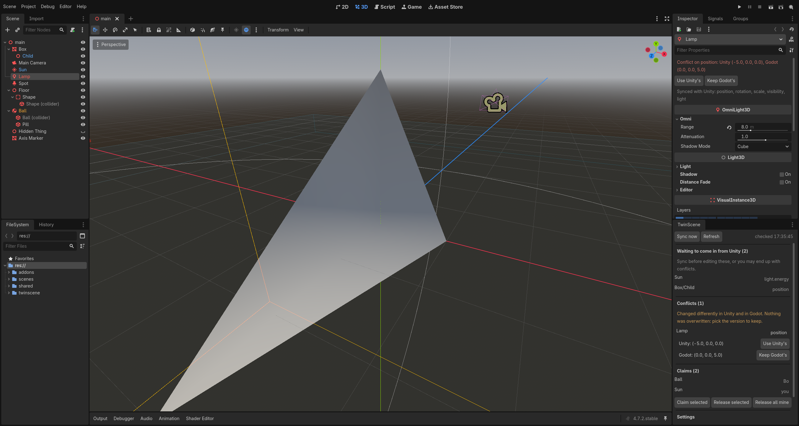

# TwinScene

[](https://github.com/davislitte/twinscene/actions/workflows/tests.yml)

Keep one game in **Unity and Godot at the same time**. One developer works in Unity, another in Godot, and a GitHub
Action turns each side's changes into a pull request for the other.

> **Status: alpha.** Scene sync works and is checked inside both real editors, including on Unity's ML-Agents
> examples (2,053 objects, all matching), but it hasn't been used by many teams yet: expect gaps, keep your project in
> git, and please [report what goes wrong](https://github.com/davislitte/twinscene/issues). Known gaps are listed in
> [docs/MAPPING.md](docs/MAPPING.md).

## Why

- **Move from Unity to Godot gradually**, without stopping work: the Unity project keeps working while the Godot
  version catches up, and changes made on either side reach the other.
- **Mixed teams**: level design, prefabs, lighting and object settings shared between a Unity and a Godot developer.

What it doesn't do is translate game code: each engine keeps its own scripts (see [Scripts](#scripts)).

## What syncs

| Syncs both ways | Stays engine-specific |
|---|---|
| Objects: names, parents, order, shown/hidden | Shaders, particles, UI |
| Prefabs (as Godot scenes) and placed prefabs (as instances) | Prefab variants (for now) |
| Edits inside placed prefabs: transforms, visibility, lights, materials, script settings | |
| Meshes from FBX/glTF files, with their materials, units and pivots | UI (Canvas / Control nodes) |
| Several colliders per object, triggers (Area3D), cylinders | Convex/concave mesh colliders |
| glTF models (Unity needs the glTFast package) | Binary Godot scenes (`.scn`) |
| Position, rotation, scale | Animation state machines |
| Primitive meshes and shared model files | Game code itself (see below) |
| Materials: colour, metallic, roughness | Settings TwinScene doesn't know (kept as they are) |
| Cameras; directional, point and spot lights | |
| Box, sphere and capsule colliders; rigid bodies | |
| Files in the shared folder (models, textures, audio) | |
| Which scripts are on an object, and their inspector settings (paired scripts) | |

TwinScene only edits what it understands: every other setting in a scene file is left exactly as it was. If both
sides change the same thing, the change is reported as a conflict instead of guessed.

### Scripts

TwinScene doesn't translate code: each developer writes gameplay in their engine's language (C# in Unity; GDScript
or C# in Godot). What it does is **pair** scripts that play the same part, by file name (`PlayerController.cs` ↔
`player_controller.gd`) or in `twinscene.json`:

```json
"scripts": {"Assets/Scripts/Enemy.cs": "res://ai/enemy_brain.gd"}
```

For paired scripts TwinScene attaches the partner script to objects the other side adds, and syncs the inspector
settings both have (`moveSpeed`, `m_MoveSpeed`, `MoveSpeed` and `move_speed` all count as the same setting), including
per-copy settings on placed prefabs. Numbers, true/false, text, vectors and colours sync. `twinscene scripts` lists
the pairs and which settings sync. Scripts without a partner stay where they are, untouched, and are listed in the
report.

## Try it

[examples/starter](examples/starter) is a small Unity level (prefabs, lights, a paired script) next to an empty Godot
project: one `twinscene sync` builds the Godot version. Its README walks through a round trip in five minutes.

## Quick start

TwinScene needs Python 3.10 or newer.

```
my-game/
  unity/          Unity 6 project (text serialization, the default)
  godot/          Godot 4.6+ project
```

```bash
pip install twinscene    # or: pip install git+https://github.com/davislitte/twinscene
cd my-game
twinscene init     # writes twinscene.json
twinscene status   # what a sync would do
twinscene sync     # do it
```

Scenes are paired by name (`Main.unity` ↔ `Main.tscn`); a scene that exists on one side only is created on the other.
Models, textures, audio and fonts are mirrored between `unity/Assets` and the Godot project at the same paths (set `"shared"` in
`twinscene.json` to narrow it). Engine files such as scenes, prefabs, materials and scripts are never copied raw.

To run it on every push and get pull requests, see [docs/github-action.md](docs/github-action.md).

**Editor add-ons** for Unity and Godot add a Sync button, labels for changes waiting from the other side, a conflict
resolver and claims ("I'm working on this"): see [docs/editor-addons.md](docs/editor-addons.md).



## How it works

- Each side is compared with **its own** snapshot from the last sync, so nothing gets lost in translation and
  re-syncing is a no-op.
- Objects are matched by the engines' own permanent IDs (Unity `fileID`, Godot 4.6+ `unique_id`), so renames and moves
  are recognised.
- Axes are converted with a rule measured in both editors: see [docs/MAPPING.md](docs/MAPPING.md).

## Development

```bash
python -m unittest discover -s tests -t .
```

`tests/tools/` holds scripts that check conversions inside the real editors. See [CONTRIBUTING.md](CONTRIBUTING.md).

## License

MIT. See [LICENSE](LICENSE).
